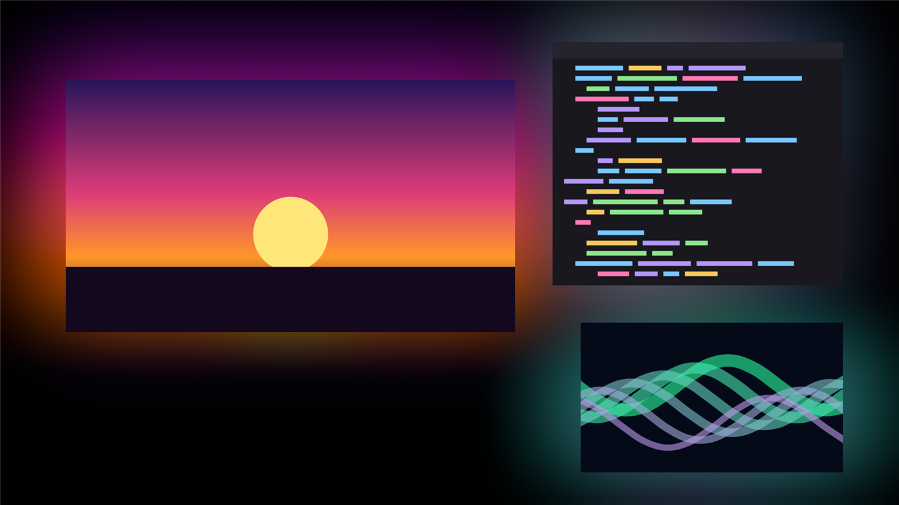
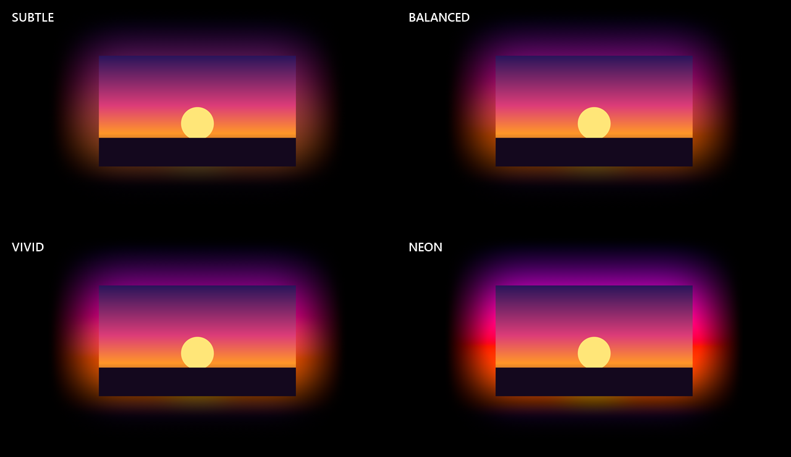
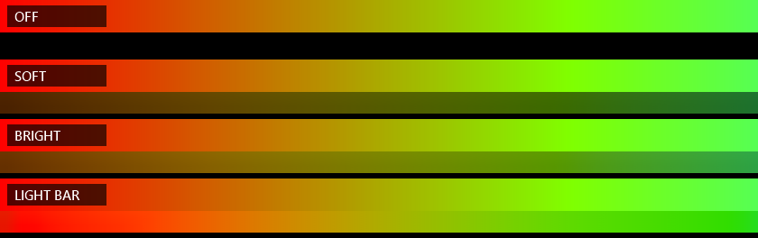

<div align="center">

# ✦ Ambient Desktop

**YouTube's ambient mode, for your entire Windows desktop.**

Your wallpaper turns pure `#000000` black, and every window you open casts a soft glow onto it,
colored by whatever is right next to its edges.




<sub>Rendered by the app's own pipeline. The glow under each window comes from the content along its edges.</sub>

</div>

---

## What it does

- 🖤 **True black desktop.** Bare desktop is exactly `#000000`. Desktop icons stay on top.
- 🌈 **Edge-aware glow.** A red scene on the left side of a video makes the left side glow red, and a
  blue sidebar on the right glows blue. The color changes along each edge.
- 🎞️ **Living light.** Colors ease smoothly as content changes, and the glow follows a window while you drag it.
- ▭ **Ambient taskbar.** Maximize a window and the taskbar picks up the colors right above it.
  One mode even turns it into an LED light bar.
- 🪶 **Featherweight.** About 2% of one CPU core with static windows. The GPU shrinks the screen,
  and the app redraws only what changed.
- 🖥️ **Multi-monitor and high-DPI aware.** It handles any mix of monitors, and survives display
  changes and Explorer restarts.

## Install

> **Requirements:** Windows 10 or 11. Nothing else, not even admin rights.

1. Download this repo (**Code → Download ZIP**) or clone it:
   ```bash
   git clone https://github.com/inoater/ater-chat.git
   ```
2. Double-click **`setup.bat`**.

That's it. Setup compiles the app from source with the C# compiler that already ships inside
Windows, so nothing is downloaded from the internet. It then installs to
`%LOCALAPPDATA%\Programs\AmbientDesktop`, adds a Start Menu entry and an entry in **Settings > Apps**,
sets the app to start with Windows, and launches it.

Run `setup.bat` again at any time to update. Optional flags: `-NoStartup`, `-NoLaunch`,
`-NoShortcuts`, `-InstallDir "D:\Somewhere"`.

## Tune it

The app lives in the system tray. **Double-click** the icon to toggle the glow, and **right-click** it for the menu:

| Setting | Options |
|---|---|
| **Intensity** | Subtle · **Balanced** · Vivid · Neon |
| **Glow size** | Tight · **Normal** · Wide · Huge |
| **Color transitions** | Snappy · **Smooth** · Cinematic |
| **Performance** | Battery saver (15 fps) · **Balanced (30 fps)** · Ultra smooth (60 fps) |
| **Ambient taskbar** | Off · Soft · **Bright** · Light bar |
| **Start with Windows** | on / off |



### Ambient taskbar

When a window is maximized, the taskbar is the only background left, so the taskbar glows too.



| Mode | Look |
|---|---|
| **Off** | Solid black |
| **Soft** | A gentle wash of the nearby colors |
| **Bright** | A stronger glow with its own brightness ceiling, so it stays lively even on *Subtle* |
| **Light bar** | Each point takes the exact color of the window edge directly above it, like LED strips behind a TV |

> The glow shines *through* the taskbar, so keep **Settings > Personalization > Colors >
> Transparency effects** on. The app nudges you if it's off.

## How it works

```mermaid
flowchart LR
    A["🪟 Find real app windows<br/><sub>EnumWindows + DWM frame bounds</sub>"] --> B
    B["📸 Capture each monitor<br/><sub>DXGI Desktop Duplication,<br/>GPU mipmaps to 1/16 scale</sub>"] --> C
    C["🔦 Keep only light<br/>from inside windows"] --> D
    D["🌫️ Blur outward<br/><sub>3 box passes ≈ Gaussian,<br/>in linear light</sub>"] --> E
    E["🎨 Grade<br/><sub>gain · saturation ·<br/>soft brightness ceiling</sub>"] --> F
    F["⏳ Ease over time<br/><sub>faster while windows move</sub>"] --> G
    G["🖼️ Upscale + dither<br/><sub>only the changed rectangle</sub>"] --> H
    H["🖤 Draw under the<br/>desktop icons"]
```



<details>
<summary><b>The details, for the curious</b></summary>

- **Where it draws.** The app plants one borderless window per monitor *inside* the Windows desktop,
  under the icons and above the wallpaper (the spot live-wallpaper apps use). It supports both the
  Windows 11 24H2+ desktop layout (a layered child window of `Progman`) and the classic `WorkerW` one.
  Your windows, taskbar and icons are never modified.
- **Capture.** DXGI Desktop Duplication hands over each monitor as a GPU texture. A mip chain shrinks
  it to a tiny grid (1/16 scale at 1080p), and a double-buffered staging texture is read back a frame
  later, so the CPU never waits for the GPU. When the screen hasn't changed, capture costs nothing.
  GDI `StretchBlt` is the fallback.
- **Light.** Only grid cells *fully inside* real app windows count as light sources, which prevents
  feedback loops with the glow itself. The light is blurred in linear color, then saturation is boosted
  and a soft knee caps brightness, so white pages glow instead of blasting you.
- **Motion.** Colors ease with an exponential time constant. When windows move, that constant
  shortens, so the glow keeps up with the window instead of trailing behind it.
- **Render.** The grid is upscaled bilinearly with 8×8 ordered dithering, so dark gradients don't band.
  Only the bounding box of cells that changed on screen is redrawn. Spans that are black on both ends
  are zero-filled, and cells buried under windows never trigger a redraw.
- **Zero dependencies.** It's plain C# 5 against .NET Framework 4.x, with raw COM vtable calls for
  D3D11/DXGI, so no NuGet, no SDK and no installer frameworks are needed.

</details>

### Performance

Measured on 3 × 1080p monitors with an RTX 3050:

| Scenario | CPU (one core) |
|---|---|
| Static windows | ~2% |
| Video behind a maximized window, taskbar glow on | ~6% |
| Worst case: the whole glow animating every frame at 30 fps | ~17% |
| Everything covered by fullscreen apps | ~0% |

## Uninstall

Double-click **`uninstall.bat`**, or go to **Settings > Apps > Ambient Desktop > Uninstall**.
Your normal wallpaper comes back the moment the app closes.

## Troubleshooting

Tray menu → **Troubleshooting**:

- **Re-attach to desktop**: brings the glow back if it ever disappears. The app also re-attaches
  on its own within a couple of seconds after Explorer restarts.
- **Log detected windows**: writes which windows count as light sources to the log.
- **Open log**: opens `%APPDATA%\AmbientDesktop\log.txt`.

## Project layout

```
setup.bat · uninstall.bat      double-click entry points
installer/                     PowerShell install / uninstall scripts
src/
  Program.cs                   entry point, single instance, CLI flags
  TrayApp.cs                   tray icon, dark menu, lifecycle
  DesktopHost.cs               attaches glow surfaces under the desktop icons
  Capture.cs                   DXGI desktop duplication (+ GDI fallback)
  AmbientEngine.cs             window detection, blur, grading, upscale
  Settings.cs                  settings, presets, autostart, log
  IconArt.cs                   the icon, drawn in code
  Native.cs                    Win32 interop
  DevTools.cs                  offline render / capture self-tests
assets/AmbientDesktop.ico      app icon (generated by the app itself)
docs/                          README images (rendered by the app's own pipeline)
```

### Dev tools

```bash
AmbientDesktop.exe --render-test out.png [--intensity 0-3] [--size 0-3] window.png x,y,w,h ...
```
```bash
AmbientDesktop.exe --capture-test prefix
```

`--render-test` previews the glow on a fake desktop (the images in this README were made this way),
and `--capture-test` dumps what the capture sees on each monitor. Setting the `AMBIENT_DEBUG=1`
environment variable logs per-stage frame timings and redraw regions.

---

<div align="center"><sub>Made for people who like their desktop dark and their content glowing.</sub></div>
